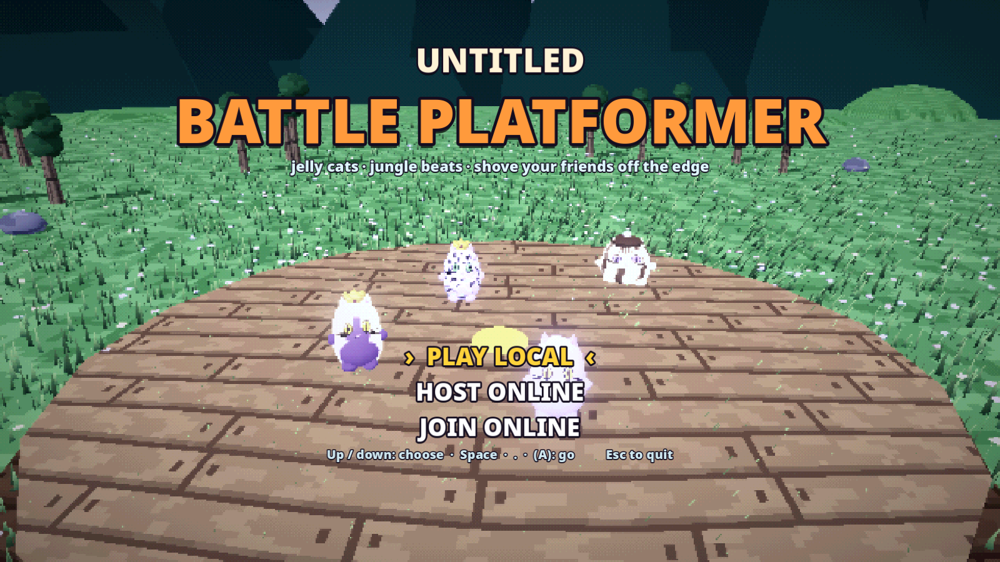

# Untitled Battle Platformer: playtest builds

A local and online party game. Jelly-bean cats shove each other off small arenas and race up a
mountain; first to win 2 rounds takes the match. Up to 10 cats, and several people can share one
PC. This repo only hosts the playtest builds.

## Download

**[Get the latest build](https://github.com/dawnmaster1337/untitled-battle-platformer-releases/releases/latest)**
and pick the zip for your system:

| System | File |
| --- | --- |
| Windows (64-bit) | `UntitledBattlePlatformer-windows-….zip` |
| macOS (Intel and Apple Silicon) | `UntitledBattlePlatformer-macos-….zip` |
| Linux (x86_64) | `UntitledBattlePlatformer-linux-….zip` |

Everyone in one game needs the same build.

## Start it

- **Windows:** unzip, run `UntitledBattlePlatformer.exe`. "Windows protected your PC" only means
  the build isn't signed: click **More info**, then **Run anyway**.
- **macOS:** unzip, open `Untitled Battle Platformer.app`. If macOS says it can't check the app,
  open **System Settings > Privacy & Security**, scroll down, click **Open Anyway** and confirm.
  If it says the app is damaged: in Terminal type `xattr -dr com.apple.quarantine ` (with the
  space at the end), drag the app onto the Terminal window and press Enter.
- **Linux:** unzip, run `./UntitledBattlePlatformer.x86_64` (`chmod +x` it if your unzip lost that).

## Play online

1. **Host:** title screen > **HOST ONLINE**. Your address shows at the top of the lobby (**F2**
   copies it): send it to the others. They connect to you on **UDP port 24680**.
2. **Join:** title screen > **JOIN ONLINE**, paste the host's address, press Enter. Make your cat
   and ready up; the host adds CPUs and starts.

If nobody can join the host:

- Allow the game through the firewall when Windows or macOS asks. On Linux with ufw, run
  `sudo ufw allow 24680/udp`, plus `sudo ufw allow proto udp from <router IP> port 1900` so the
  router's UPnP reply gets through (otherwise the lobby says no UPnP router answered).
- If the lobby says the router didn't open the port, forward UDP 24680 to the host PC in the
  router settings, or everyone installs [Tailscale](https://tailscale.com) and joins the host's
  Tailscale address.

## Controls

| Action | Keys (left) | Keys (right) | Gamepad |
| --- | --- | --- | --- |
| Move | WASD | Arrows | Left stick / D-pad |
| Jump | Space | `.` | A |
| Dive (also mid-air) | Shift / C | `,` | B |
| Grab (hold) | E | `/` | RB / LB / RT |
| Push | Q | M | X / Y |
| Menu | Esc | Esc | Start |

Grabbed? Mash jump to wriggle free. In the lobby, press jump on any keyboard half or gamepad to
add a player.

## Found a bug?

[Open an issue](https://github.com/dawnmaster1337/untitled-battle-platformer-releases/issues) with what
happened, which build, and your `godot.log` (the host's too if you can):

- Windows: `%APPDATA%\Godot\app_userdata\Untitled Battle Platformer\logs`
- macOS: `~/Library/Application Support/Godot/app_userdata/Untitled Battle Platformer/logs`
- Linux: `~/.local/share/godot/app_userdata/Untitled Battle Platformer/logs`

A last log line `Attempt to disconnect a nonexistent connection` is a known, harmless error: no
need to report it.
